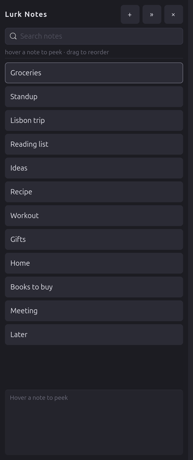
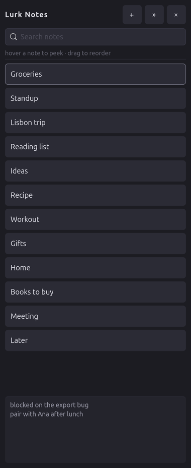
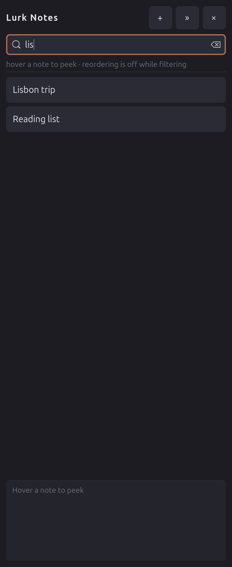
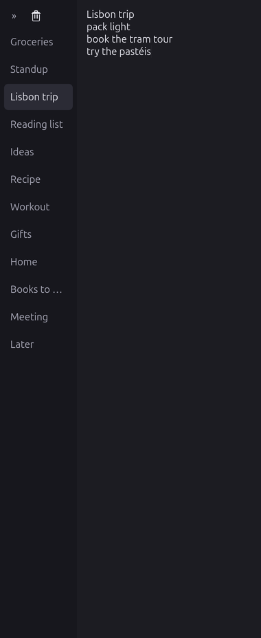
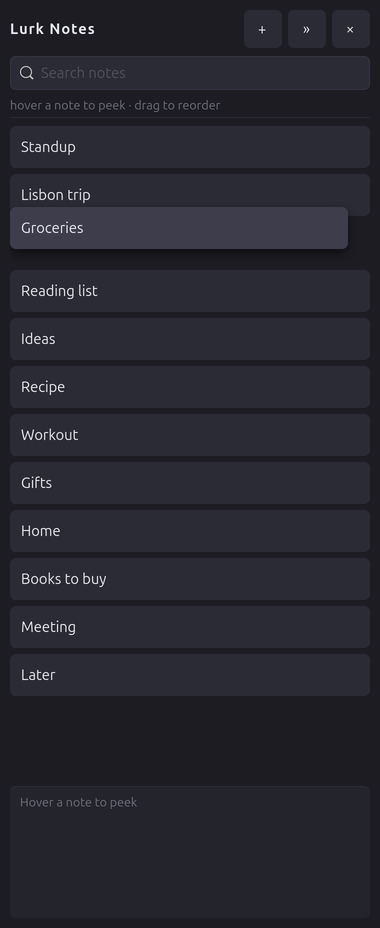
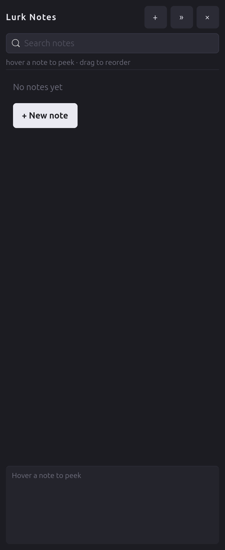

# LurkNotes

Notes deck at the right edge of the screen for Ubuntu 24.04 / GNOME 46.
Spec: [.scratch/edge-notes/spec.md](.scratch/edge-notes/spec.md).
Plan: [.scratch/edge-notes/plan.md](.scratch/edge-notes/plan.md).

## Screenshots



The fan at the right edge: search over the notes list, the 10 px strip on the right.

| Peek | Search |
|:---:|:---:|
|  |  |
| **Hover a tab to peek** | **Filter the deck as you type** |

| Editor | Drag reorder |
|:---:|:---:|
|  |  |
| **One note, rail and editor** | **The rows make room for the dragged tab** |



Screenshots are generated from the real app by `scripts/screenshots.py` (isolated
data, real X11 windows), so they can be refreshed after UI changes.

## Install

LurkNotes uses GTK 4 and PyGObject from the system, so install those first
(Ubuntu 24.04):

```sh
sudo apt install python3-gi gir1.2-gtk-4.0
```

**pipx** (from the release tarball):

```sh
sudo apt install pipx
pipx install --system-site-packages \
  https://github.com/hoter/lurknotes/releases/download/v0.1.0/lurknotes-0.1.0.tar.gz
lurknotes --install-autostart   # optional: start the strip at login
```

`--system-site-packages` is required: PyGObject is not on PyPI and must match
the installed GTK.

**Debian package:**

```sh
sudo apt install ./lurknotes_0.1.0_all.deb
lurknotes --install-autostart
```

The app needs an X11/XWayland session; GNOME 46 on Wayland works through
XWayland. `lurknotes --version` prints the installed version, and
`lurknotes --help` lists the commands.

## Run

```sh
./lurknotes            # show the deck; the fan expands immediately
./lurknotes new        # create a note at the top and open the editor
./lurknotes --autostart # quiet session start: only the strip, no focus
```

The process stays in the foreground; `Ctrl+C` in the terminal stops it.
`lurknotes` is a single instance: a second invocation hands its command to
the running process and exits with that process' exit code, so `new`
works from a terminal, a hotkey or a script without starting a second deck.

`new` while an untouched note is already open focuses that note instead of
stacking another empty one. Hover never takes keyboard focus; after `new`
the app asks for activation and, if the window did not get the keyboard within
150 ms, the panel shows **Click to type**. The first click anywhere on the panel
takes input and focuses the editor.

`./lurknotes --help` prints usage. Unknown arguments and options exit with
status 2.

## Hotkeys

GNOME 46 has no global-shortcut portal, so bind the command once by hand:

1. Open **Settings → Keyboard → Keyboard Shortcuts → Custom Shortcuts**.
2. Add `Ctrl+Alt+N` running the absolute path to `lurknotes new`.

The first visible deck shows the same instructions once and records that in
`$XDG_DATA_HOME/lurknotes/onboarded`; it is never shown again.

## Autostart

Install the per-user session entry once:

```sh
./lurknotes --install-autostart
```

It writes `$XDG_CONFIG_HOME/autostart/dev.lurknotes.LurkNotes.desktop`
(usually `~/.config/autostart/`) with an absolute `Exec=... --autostart`.
After the next login only the strip is mapped: the fan stays closed, keyboard
focus is not taken and no note is created. Run the same command again to
refresh the entry; delete the file to disable autostart.

## Data

Notes live in `$XDG_DATA_HOME/lurknotes/notes.json`
(usually `~/.local/share/lurknotes/notes.json`) with `notes.bak.json` beside
it. Nothing is written outside `$XDG_DATA_HOME` and `~/.config`.

## Test

```sh
python3 -m venv --system-site-packages .venv
.venv/bin/pip install pytest pillow

.venv/bin/python -m pytest
.venv/bin/python scripts/smoke.py
.venv/bin/python scripts/smoke_note.py
.venv/bin/python scripts/smoke_hover.py
.venv/bin/python scripts/smoke_delete.py
.venv/bin/python scripts/smoke_storage.py
.venv/bin/python scripts/smoke_drag.py
.venv/bin/python scripts/smoke_integration.py
.venv/bin/python scripts/acceptance.py

.venv/bin/python scripts/screenshots.py   # refresh docs/screenshots
```

The venv needs `--system-site-packages`: PyGObject and GTK 4 come from the
system and must match the installed GTK, not from PyPI.

Each smoke starts its own instance against temporary XDG directories, uses a
unique application id, checks the real X11 windows, then stops the process it
started. `acceptance.py` covers the remaining MVP criteria and measurements
(cold/warm start, idle RSS/CPU, real 10 s undo, fullscreen stacking, no-network
sockets, `kill -9` stress); its report is
[.scratch/lurknotes-mvp/acceptance.md](.scratch/lurknotes-mvp/acceptance.md).
